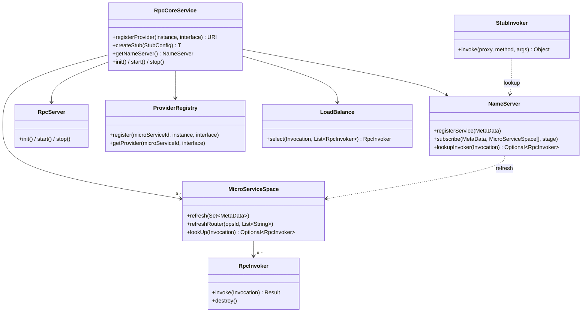
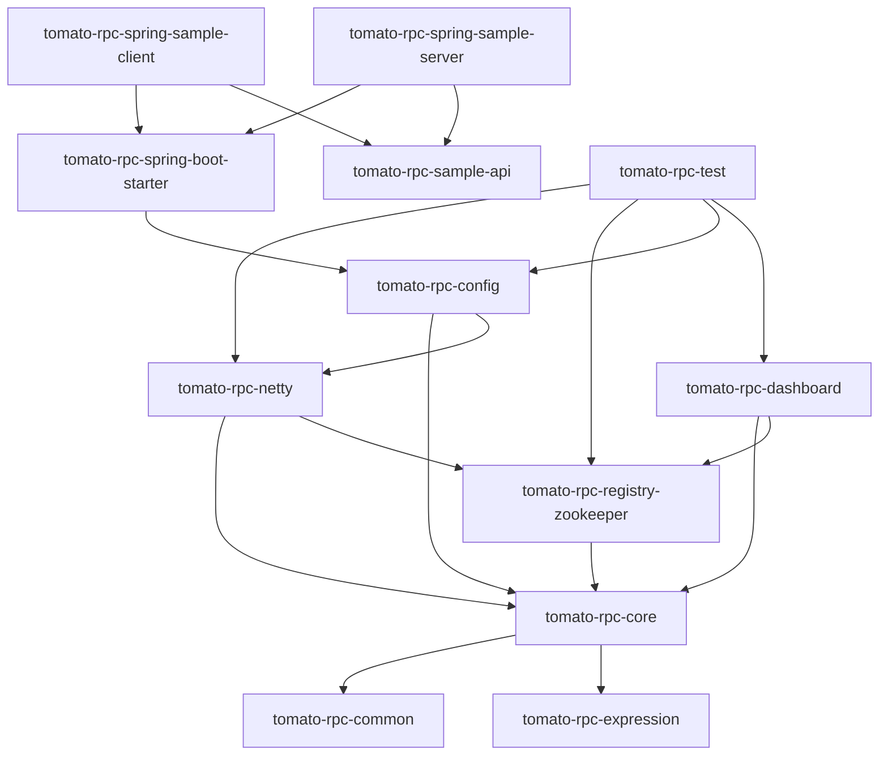

# 项目总览

## 一句话定位

Tomato-RPC 是一个**以学习为目的**的 RPC 框架实践项目：用 Netty 实现网络通信、用 ZooKeeper 实现注册与发现，并在其上补齐了动态代理、序列化、路由灰度、负载均衡、熔断、SPI 与 Spring Boot 自动装配等 RPC 框架的常见件。设计思路上参考了 dubbo、feign 的实现方式。

它不是生产级框架，代码里的取舍以「把原理跑通、把链路看清」为第一优先级（例如熔断计数器用 FenwickTree 实现，作者本人在注释里也说明是为了巩固数据结构）。

## 技术栈

| 类别         | 选型                                  | 版本                     | 说明                                                         |
| ------------ | ------------------------------------- | ------------------------ | ------------------------------------------------------------ |
| 语言与运行时 | OpenJDK                               | 17                       | 使用了 `record`、文本块、`instanceof` 模式匹配               |
| 构建         | Maven 多模块                          | —                        | 根 `pom.xml` 统一管理版本                                    |
| 网络         | Netty                                 | 4.1.97.Final             | 优先 Epoll，退化为 NIO                                       |
| 注册中心     | ZooKeeper / Curator                   | 3.5.9 / 5.9.0            | 临时节点 + PathChildrenCache 语义的手写 Watcher              |
| 序列化       | Protostuff / Jackson                  | 1.8.0 / 2.19.0           | Protostuff 索引 0，JSON 索引 1                               |
| 容器集成     | Spring Boot                           | 3.2.12                   | `spring.factories` + `AutoConfiguration.imports` 双注册      |
| 工具         | commons-lang3 / collections4 / Lombok | 3.18.0 / 4.5.0 / 1.18.42 | —                                                            |
| 测试         | JUnit 4 / Mockito / curator-test      | 4.12 / 5.20.0            | 集成测试内嵌 `TestingServer`                                 |
| 覆盖率       | JaCoCo                                | 0.8.11                   | 报告输出到 `target/coverage-reports`                         |
| 日志         | log4j2 + disruptor                    | —                        | 见 [tomato-rpc-log4j2-config](./modules/samples-and-test.md) |

## 术语表

| 术语                | 含义                                                                           | 对应类型                   |
| ------------------- | ------------------------------------------------------------------------------ | -------------------------- |
| micro-service-id    | 微服务唯一标识，一个 id 对应一组等价实例                                       | `RpcConfig#microServiceId` |
| stage               | 部署环境（dev / gray / prod…），用于环境隔离                                   | `RpcConfig#stage`          |
| group               | 同环境下的分组，用于灰度与联调隔离                                             | `RpcConfig#group`          |
| node / 实例         | 一个进程暴露的 RPC 端口，注册中心里的一条记录                                  | `MetaData`                 |
| provider            | 服务端接口实现对象                                                             | `ProviderRegistry`         |
| invoker             | 客户端与**某个具体实例**之间的通信句柄（持有 TCP 连接）                        | `RpcInvoker`               |
| stub                | 客户端拿到的接口代理对象                                                       | `StubInvoker` + JDK Proxy  |
| command             | 一帧协议数据（帧头 + 扩展头 + body）                                           | `Command`                  |
| micro-service-space | 一个被订阅微服务的实例集合 + 路由规则 + 负载均衡入口                           | `MicroServiceSpace`        |
| apiId               | 方法级标识 `microServiceId$interfaceName$methodName`，负载均衡与熔断的统计单位 | `Invocation#getApiId`      |
| nodeProperty        | 实例的自定义属性，目前只有 `weight`                                            | `MetaData.NodeProperty`    |

## 领域模型

仓库里已有的 UML：[tomato_rpc_model.svg](../uml/tomato_rpc_model.svg)、[tomato_rpc_invocation.svg](../uml/tomato_rpc_invocation.svg)。

## 模块地图

根 `pom.xml` 声明了 15 个模块，分「框架模块」与「样例模块」两类。

| 模块                            | 类型 | 职责                                                                                                                            | 主要依赖                 | 文档                                                                        |
| ------------------------------- | ---- | ------------------------------------------------------------------------------------------------------------------------------- | ------------------------ | --------------------------------------------------------------------------- |
| tomato-rpc-common               | 支撑 | 日志门面 `Logger`（DEFAULT/DIGEST 双通道）、`FenwickTree`、`NetworkUtil`、`ReflectUtils`、监控路径常量                          | 无                       | [模块说明](./modules/tomato-rpc-common.md)                                  |
| tomato-rpc-expression           | 支撑 | 路由规则表达式的词法分析、AST 构建与求值                                                                                        | 无                       | [模块说明](./modules/tomato-rpc-expression.md) / [机制](./12-expression.md) |
| tomato-rpc-core                 | 框架 | 全部抽象与协议无关实现：生命周期、数据模型、协议对象、SPI、路由、负载均衡、熔断、序列化、注册中心抽象、stub/invoker/server 抽象 | common、expression       | [模块说明](./modules/tomato-rpc-core.md)                                    |
| tomato-rpc-netty                | 框架 | Netty 传输实现：编解码、客户端/服务端、连接与心跳、超时、`ServerHandler`                                                        | core、registry-zookeeper | [模块说明](./modules/tomato-rpc-netty.md)                                   |
| tomato-rpc-registry-zookeeper   | 框架 | ZooKeeper 注册中心实现（注册/订阅/Watcher/路由规则存取）                                                                        | core                     | [模块说明](./modules/tomato-rpc-registry-zookeeper.md)                      |
| tomato-rpc-config               | 接入 | Spring Boot 自动装配、注解与 Bean 后置处理、服务本地监控 Controller                                                             | core、netty              | [模块说明](./modules/tomato-rpc-config.md)                                  |
| tomato-rpc-spring-boot-starter  | 接入 | 空壳聚合模块，只依赖 config                                                                                                     | config                   | [模块说明](./modules/tomato-rpc-spring-boot-starter.md)                     |
| tomato-rpc-dashboard            | 运营 | 独立的运营端应用：查询实例、查看/下发路由规则                                                                                   | core、registry-zookeeper | [模块说明](./modules/tomato-rpc-dashboard.md)                               |
| tomato-rpc-sample-api           | 样例 | 公共接口包（`EchoService`、`SumService`、`ExecutionChainFacade` 及 DTO）                                                        | —                        | [样例说明](./modules/samples-and-test.md)                                   |
| tomato-rpc-sample-client        | 样例 | 手动接入的客户端                                                                                                                | sample-api、netty 等     | [样例说明](./modules/samples-and-test.md)                                   |
| tomato-rpc-sample-server        | 样例 | 手动接入的服务端                                                                                                                | sample-api 等            | [样例说明](./modules/samples-and-test.md)                                   |
| tomato-rpc-spring-sample-client | 样例 | Spring 接入的客户端（多 profile 灰度演示）                                                                                      | starter、sample-api      | [样例说明](./modules/samples-and-test.md)                                   |
| tomato-rpc-spring-sample-server | 样例 | Spring 接入的服务端（多 profile 环境演示）                                                                                      | starter、sample-api      | [样例说明](./modules/samples-and-test.md)                                   |
| tomato-rpc-log4j2-config        | 支撑 | 共享 log4j2.xml                                                                                                                 | —                        | [样例说明](./modules/samples-and-test.md)                                   |
| tomato-rpc-test                 | 测试 | 所有模块的单测与集成测试                                                                                                        | 全部框架模块             | [测试说明](./13-testing.md)                                                 |

### 模块依赖

> 注意 `tomato-rpc-netty` 在 `<dependencies>` 中直接依赖了 `tomato-rpc-registry-zookeeper`（见 `tomato-rpc-netty/pom.xml`），所以「引入 netty 实现」会顺带把 ZooKeeper 注册中心实现带进 classpath，SPI 才能默认加载到 `zookeeper-factory`。

## 推荐阅读路径

| 目标                  | 阅读顺序                                                                                          |
| --------------------- | ------------------------------------------------------------------------------------------------- |
| 先跑起来              | [快速开始](./02-quick-start.md) → [部署样例](./14-deployment.md)                                  |
| 看懂一次 RPC 调用     | [通信协议](./04-protocol.md) → [调用链路](./05-invocation.md) → [Netty 传输层](./06-transport.md) |
| 看懂服务治理          | [注册中心](./07-registry-zookeeper.md) → [服务治理](./08-governance.md)                           |
| 想替换组件 / 扩展实现 | [SPI 与生命周期](./09-spi-lifecycle.md) → [架构与接口契约](./03-architecture.md)                  |
| 想接入业务            | [快速开始](./02-quick-start.md) → [Spring 集成](./10-spring.md)                                   |

`04-protocol.md`、`05-invocation.md`、`06-transport.md` 三篇是网络通信模块的核心，如果只关心「框架怎么把一次方法调用变成网络包、再把结果变回对象」，读这三篇即可。
