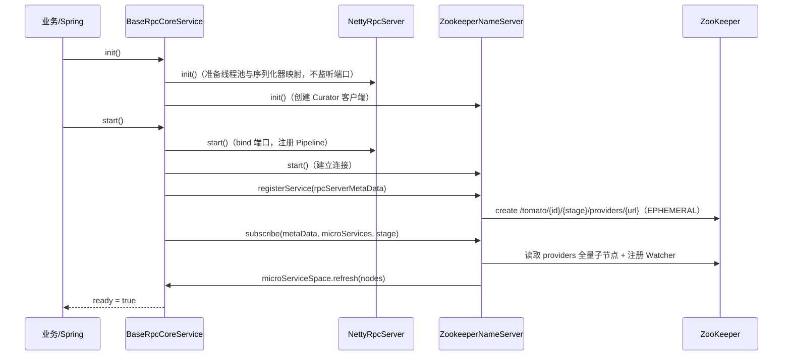

# 架构与接口契约

## 分层

```text
┌──────────────────────────────────────────────────────────┐
│ 接入层  tomato-rpc-config / spring-boot-starter / dashboard│
├──────────────────────────────────────────────────────────┤
│ 实现层  tomato-rpc-netty（传输）  tomato-rpc-registry-zookeeper（注册中心）│
├──────────────────────────────────────────────────────────┤
│ 抽象层  tomato-rpc-core（协议对象、生命周期、路由、均衡、熔断、SPI、stub/invoker/server 抽象）│
├──────────────────────────────────────────────────────────┤
│ 支撑层  tomato-rpc-common / tomato-rpc-expression          │
└──────────────────────────────────────────────────────────┘
```

设计原则只有一条：**core 里不出现 Netty 与 ZooKeeper 的具体类型**。`RpcServer`、`NameServer`、`RpcInvoker`、`StubFactory`、`Serializer`、`LoadBalance` 等接口全部声明在 core，实现由 SPI 注入。这让「换传输」「换注册中心」变成换一个 `META-INF/tomato` 文件。

唯一一处例外是 core 的 `data.Command` 直接依赖序列化器 SPI，但没有依赖任何 Netty 类；编解码在 `tomato-rpc-netty` 的 codec 包中完成。

## 启动时序

服务端 `RpcCoreService.start()` 的完整动作：



关闭顺序与之对称：`unsubscribe` → `unregisterService` → 关闭每个 `MicroServiceSpace`（销毁 invoker 即断开连接）→ `rpcServer.stop()` → `nameServer.stop()`，见 [BaseRpcCoreService](../tomato-rpc-core/src/main/java/org/tomato/study/rpc/core/base/BaseRpcCoreService.java)。

## 生命周期状态机

所有组件继承 `BaseLifeCycleComponent`，状态用 `AtomicIntegerFieldUpdater` 做 CAS 流转：

```text
CREATED --init()--> INIT --> INIT_FINISHED --start()--> START --> START_FINISHED --stop()--> STOP --> STOP_FINISHED
```

三个方法都是「CAS 抢不到就静默返回」，所以 `init()` 重复调用、`stop()` 在未启动时调用都不会抛异常；只有「进入中间态后无法推进到终态」才会抛 `RPC_COMPONENT_LIFE_CYCLE_INVALID_STATE`。

> 现状说明：`LifeCycle` 提供了 `addListener/removeListener/getListeners`，但 `BaseLifeCycleComponent` 在状态流转时**没有**回调这些监听者（全仓库没有消费方）。它是一个预留扩展点，不是可用的钩子。

## 核心接口契约

| 接口                    | 位置                                                                                              | 关键方法                                                                                | 契约要点                                                              |
| ----------------------- | ------------------------------------------------------------------------------------------------- | --------------------------------------------------------------------------------------- | --------------------------------------------------------------------- |
| `RpcCoreService`        | [core](../tomato-rpc-core/src/main/java/org/tomato/study/rpc/core/RpcCoreService.java)            | `registerProvider` / `createStub` / `getNameServer`                                     | 门面。同时是服务端与客户端：既能注册自己，也能订阅别人                |
| `RpcCoreServiceFactory` | [core](../tomato-rpc-core/src/main/java/org/tomato/study/rpc/core/RpcCoreServiceFactory.java)     | `create(RpcConfig)`                                                                     | SPI 入口，`@SpiInterface("netty")`                                    |
| `NameServer`            | [core](../tomato-rpc-core/src/main/java/org/tomato/study/rpc/core/registry/NameServer.java)       | `registerService` / `unregisterService` / `subscribe` / `unsubscribe` / `lookupInvoker` | 抽象「注册 + 发现 + 通知」；`lookupInvoker` 是客户端每次调用的起点    |
| `MicroServiceSpace`     | [core](../tomato-rpc-core/src/main/java/org/tomato/study/rpc/core/router/MicroServiceSpace.java)  | `refresh` / `refreshRouter` / `lookUp`                                                  | 一个被订阅服务的实例视图；`refresh` 必须幂等                          |
| `Router`                | [core](../tomato-rpc-core/src/main/java/org/tomato/study/rpc/core/router/Router.java)             | `matchInvoker`                                                                          | 只判断「这个 invoker 能不能接这单」，不做选择                         |
| `LoadBalance`           | [core](../tomato-rpc-core/src/main/java/org/tomato/study/rpc/core/loadbalance/LoadBalance.java)   | `select(Invocation, List<RpcInvoker>)`                                                  | 在路由后的候选集中选一个；列表为空返回 `null`                         |
| `RpcInvoker`            | [core](../tomato-rpc-core/src/main/java/org/tomato/study/rpc/core/invoker/RpcInvoker.java)        | `invoke(Invocation)` / `destroy()`                                                      | 一个实例一个 invoker，持有长连接；必须支持并发调用                    |
| `RpcInvokerFactory`     | [core](../tomato-rpc-core/src/main/java/org/tomato/study/rpc/core/invoker/RpcInvokerFactory.java) | `create(MetaData, RpcConfig)`                                                           | 由 `MicroServiceSpace` 调用，`MetaData` 为空时返回 `Optional.empty()` |
| `StubFactory`           | [core](../tomato-rpc-core/src/main/java/org/tomato/study/rpc/core/stub/StubFactory.java)          | `createStub(StubConfig)`                                                                | 默认 JDK 动态代理                                                     |
| `StubInvoker`           | [core](../tomato-rpc-core/src/main/java/org/tomato/study/rpc/core/stub/StubInvoker.java)          | `invoke(proxy, method, args)`                                                           | 把反射调用翻译成 `Invocation`，再转成 `Result`                        |
| `RpcServer`             | [core](../tomato-rpc-core/src/main/java/org/tomato/study/rpc/core/server/RpcServer.java)          | `init/start/stop`                                                                       | 只负责「收包 → 交给 handler」，不关心业务                             |
| `ServerHandler`         | [core](../tomato-rpc-core/src/main/java/org/tomato/study/rpc/core/ServerHandler.java)             | `handle(Command)` / `getType()` / `setProviderRegistry`                                 | 按 `CommandType` 分发；JDK `ServiceLoader` 加载                       |
| `CommandInterceptor`    | [core](../tomato-rpc-core/src/main/java/org/tomato/study/rpc/core/CommandInterceptor.java)        | `interceptRequest` / `postProcessResponse`                                              | 双向拦截，目前只有压缩实现                                            |
| `ProviderRegistry`      | [core](../tomato-rpc-core/src/main/java/org/tomato/study/rpc/core/ProviderRegistry.java)          | `register` / `getProvider`                                                              | key 为 `microServiceId + 接口全名`                                    |
| `Serializer`            | [core](../tomato-rpc-core/src/main/java/org/tomato/study/rpc/core/serializer/Serializer.java)     | `serialize` / `deserialize` / `serializerIndex`                                         | 索引写进帧头，用于对端反序列化                                        |

## 线程归属

理解并发行为的关键是先弄清「谁在哪个线程上执行」。

| 线程                                               | 产生方                                              | 干什么                                                     |
| -------------------------------------------------- | --------------------------------------------------- | ---------------------------------------------------------- |
| 业务线程（调用方）                                 | 业务自己                                            | 执行 `stub.method()`，在 `Result#getResultSync` 上阻塞等待 |
| `netty-boss`                                       | `NettyRpcServer`                                    | accept 连接                                                |
| `netty-worker`                                     | `NettyRpcServer`                                    | 读写 IO、编解码、Pipeline 上的 handler                     |
| `netty-business`                                   | `NettyRpcServer`（`businessThreadPoolSize > 1` 时） | 执行业务方法反射调用，与 IO 线程隔离                       |
| `invoker-refresh-thread`                           | `BaseNameServer`                                    | 串行消费实例变更事件，重建 invoker                         |
| `netty-timeout-timer`（HashedWheelTimer 内部线程） | `NettyRpcInvokerFactory` 共享                       | 扫描超时任务，超时则失败对应 future                        |

## 设计取舍与现状

| 主题           | 现状                                                        | 备注                                                                       |
| -------------- | ----------------------------------------------------------- | -------------------------------------------------------------------------- |
| 协议版本       | `version` 字段恒为 `20210403`，解码不校验                   | 为将来协议演进预留                                                         |
| 序列化         | 默认 key 为 `json`（`@SpiInterface("json")`），帧头携带索引 | 想要 protobuf 风格体积可改成 `protostuff`，见 [SPI](./09-spi-lifecycle.md) |
| 超时           | 只有客户端有一道时间轮超时                                  | 服务端不感知 deadline，`TIMEOUT` 扩展头目前只做透传                        |
| 心跳           | 客户端按写空闲触发                                          | 服务端读空闲直接断连，不做双向保活探测                                     |
| 优雅关闭       | `BaseRpcInvoker` 等待在途请求最多 60s                       | 见 [调用链路](./05-invocation.md#优雅关闭)                                 |
| 服务端并发保护 | 业务线程池拒绝策略为 `AbortPolicy`，只打日志                | 不反压到客户端，客户端表现为超时                                           |
| 注册中心事件   | 单线程串行 refresh                                          | 避免并发重建 invoker，但实例抖动大会排队                                   |
