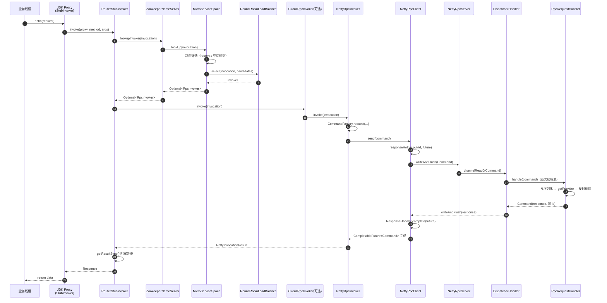

# 调用链路

> 网络通信模块第二篇：**一次 `stub.echo(...)` 从线程栈走到网卡，再走回来**。协议字节布局见 [通信协议](./04-protocol.md)，Netty 侧的连接与线程细节见 [Netty 传输层](./06-transport.md)。

## 全景



## 客户端：从代理到网络

### 1. 创建代理

`RpcCoreService#createStub` → `StubFactory#createStub` → [BaseStubFactory](../tomato-rpc-core/src/main/java/org/tomato/study/rpc/core/stub/BaseStubFactory.java)：

```java
StubInvoker stubInvoker = invokerFactory.createStubInvoker(config, rpcConfig).orElse(null);
```

`BaseRpcInvokerFactory#createStubInvoker` 在这里分叉：

| 条件                                    | 产物                | 寻址方式                                     |
| --------------------------------------- | ------------------- | -------------------------------------------- |
| `StubConfig.nameServer != null`         | `RouterStubInvoker` | 每次调用问注册中心要一个 invoker（默认路径） |
| `nameServer == null` 且 `nodeInfo` 合法 | `DirectStubInvoker` | 直连指定节点                                 |

最后由 `JdkStubFactory` 生成 JDK 动态代理，`InvocationHandler` 只做一件事——把调用交给 `StubInvoker#invoke`。

### 2. 组装调用上下文

[BaseStubInvoker#invoke](../tomato-rpc-core/src/main/java/org/tomato/study/rpc/core/stub/BaseStubInvoker.java) 承担三件事：

```java
// ① 保存现场
Map<String, String> originContext = InvocationContext.get();
Map<String, String> mdcContext = MDC.getCopyOfContextMap();
Map<String, String> currentContext = originContext == null
        ? InvocationContext.initContext()
        : new HashMap<>(originContext);
InvocationContext.set(currentContext);
MDC.put(ExtensionHeader.TRACE_ID.name(), ExtensionHeader.TRACE_ID.getValueFromContext());

// ② 写入本次调用的参数
currentContext.put(ExtensionHeader.TIMEOUT.getKeyName(), String.valueOf(stubConfig.getTimeoutMs()));
currentContext.put(ExtensionHeader.COMPRESS.getKeyName(), String.valueOf(stubConfig.isCompressBody()));

// ③ 反射信息 → Invocation
Invocation invocation = createInvocation(method, args);
```

| 细节       | 说明                                                                                                        |
| ---------- | ----------------------------------------------------------------------------------------------------------- |
| 上下文继承 | 若当前线程已有 context（说明自己是「上游调用的服务端」），复制一份继续往下传，实现链路透传                  |
| traceId    | 只有 context 为 null 时才新生成 32 位 UUID（无 `-`），保证一整条链路同一个 traceId                          |
| 方法信息   | `microServiceId`、`interfaceName`、`methodName`、`argsTypes`、`returnType`、`args` 全部塞进 `RpcRequestDTO` |
| 收尾       | `finally` 中恢复 `InvocationContext` 与 MDC，不污染调用方线程                                               |

`Object` 方法（`toString`/`hashCode`/`equals`）在本地直接处理，不会发出网络请求。

### 3. 选一个实例

`RouterStubInvoker#doInvoke` 只做两件事：要 invoker、判结果。

```java
Optional<RpcInvoker> invokerOpt = nameServer.lookupInvoker(invocation);
if (invokerOpt.isEmpty()) {
    throw new TomatoRpcRuntimeException(TomatoRpcErrorEnum.STUB_INVOKER_SEARCH_ERROR, "invoker not found, ...");
}
Response response = invokerOpt.get().invoke(invocation).getResultSync();
if (TomatoRpcErrorEnum.SUCCESS.getCode() != response.getCode()) {
    throw new TomatoRpcRuntimeException(TomatoRpcErrorEnum.valueOfCode(response.getCode()), ...);
}
```

`lookupInvoker` 最终落到 [BaseMicroServiceSpace#lookUp](../tomato-rpc-core/src/main/java/org/tomato/study/rpc/core/router/BaseMicroServiceSpace.java)：

1. 用当前线程的 `InvocationContext` 构造 `ExpressionCalcContext`（请求侧变量）。
2. 按顺序遍历 `routers`：先 `router.matchRequest(context)` 判断这条规则管不管这单；再对每个 invoker 做 `matchInvoker`（用节点属性求值）。
3. **一旦某条规则筛出了候选集就停止**，后续规则不再参与——即「首个命中生效」，规则顺序就是优先级。
4. 把候选集交给 `LoadBalance#select`；候选为空时返回 `Optional.empty()`，外层报 `invoker not found`。

> 订阅时会调用一次 `refreshRouter(INITIAL_ROUTER_OPS_ID, ...)`，把兜底规则（`group == "自身分组"`）装进 `routers`。如果从没订阅过，`routers` 是空列表，`lookUp` 必然找不到 invoker。详见 [服务治理](./08-governance.md)。

### 4. 熔断包装

`RpcConfig.enableCircuit() == true` 时，`BaseMicroServiceSpace#createInvoker` 会用 `CircuitRpcInvoker` 包一层（由 `NettyMicroServiceSpace#doCreateCircuitBreaker` 提供实现）：

```java
CircuitBreaker breaker = breakerMap.computeIfAbsent(invocation.getApiId(), key -> factory.createBreaker(rpcConfig));
if (!breaker.allow()) {
    throw new TomatoRpcException(TomatoRpcErrorEnum.RPC_CIRCUIT_ERROR, ...);
}
Result result = rpcInvoker.invoke(invocation);
result.getResultAsync().handleAsync((response, exception) -> {
    doHandle(response, exception, breaker);   // 成功/失败计数 + 状态流转
    return response;
});
```

粒度是 **apiId**（`microServiceId$interfaceName$methodName`），一个实例一个包装器、一个方法一个断路器。

### 5. 变成协议帧

[NettyRpcInvoker#doInvoke](../tomato-rpc-netty/src/main/java/org/tomato/study/rpc/netty/invoker/NettyRpcInvoker.java)：

```java
Map<String, String> contextMap = InvocationContext.get();
Command rpcRequest = CommandFactory.request(invocation, getSerializer(), contextMap, CommandType.RPC_REQUEST);
rpcRequest = beforeSendRequest(rpcRequest);       // 按需 gzip
ResponseFuture<Command> responseFuture = rpcClient.send(rpcRequest);
addTimeoutTask(invocation, rpcRequest, responseFuture);   // 时间轮
return new NettyInvocationResult(responseFuture);
```

- `getSerializer()` 来自 `BaseRpcInvoker` 构造时 SPI 加载的序列化器，默认 `json`，索引写进帧头。
- `beforeSendRequest` 只判断 `ExtensionHeader.COMPRESS.getValueFromContext()` 是否为 `"true"`，是则 `GzipUtils.gzip(body)` 并 `changeBody`（同步修正 `length`）。
- 注意 `doInvoke` **不阻塞**：它立刻返回 `Result`，阻塞发生在 `RouterStubInvoker` 调 `getResultSync()` 时。

### 6. 发送并登记 future

[NettyRpcClient#send](../tomato-rpc-netty/src/main/java/org/tomato/study/rpc/netty/transport/client/NettyRpcClient.java)：

```java
long id = msg.getHeader().getId();
CompletableFuture<Command> future = new CompletableFuture<>();
Channel connection = createOrReconnect().getChannel();

connection.writeAndFlush(msg).addListener((ChannelFutureListener) futureChannel -> {
    if (futureChannel.isSuccess()) {
        responseHolder.putFeatureResponse(id, future);   // 写成功后才登记
    } else {
        future.completeExceptionally(new TomatoRpcRuntimeException(..., NETTY_CLIENT_RPC_ERROR));
    }
});
return new ClientResponseFuture(id, future, responseHolder);
```

发送与登记的顺序值得注意：**先写、后在写成功的回调里登记 future**。如果服务端在登记之前就把响应送回来，`ResponseHandler` 找不到对应 id，会直接丢弃这一帧，调用方只能等超时。这是一条真实存在的竞态窗口（README 的压测场景下极难触发，但同步极快的本地调用理论上可能命中）。

### 7. 超时

每个 `NettyRpcInvoker` 持有一个 `HashedWheelTimer(100, TimeUnit.MILLISECONDS)`，超时时间优先取扩展头里的 `TIMEOUT`，否则用 `RpcConfig.globalClientTimeoutMilliseconds()`（默认 50000）：

```java
private record RpcTimeoutTask(Command request, ResponseFuture<Command> responseFuture, Invocation invocation)
        implements TimerTask {
    @Override
    public void run(Timeout timeout) {
        responseFuture.destroy().ifPresent(future -> future.completeExceptionally(
            new TomatoRpcRuntimeException(TomatoRpcErrorEnum.RPC_INVOCATION_TIMEOUT, ...)));
    }
}
```

`destroy()` 会 `responseHolder.getAndRemove(id)`——**先从 map 移除，再让 future 异常完成**。这保证「迟到的响应」不会把已经超时的调用又写一次（此时 map 里已经没有它了）。

### 8. 拿结果

[NettyInvocationResult](../tomato-rpc-netty/src/main/java/org/tomato/study/rpc/netty/data/NettyInvocationResult.java) 是 `Result` 的实现：

| 方法               | 行为                                                                                                                                                                                    |
| ------------------ | --------------------------------------------------------------------------------------------------------------------------------------------------------------------------------------- |
| `getResultSync()`  | `getResultAsync().get(Integer.MAX_VALUE, SECONDS)`；`TimeoutException` 直接转成 `RPC_INVOCATION_TIMEOUT` 响应                                                                           |
| `getResultAsync()` | `future.thenApply(...)` 用响应帧头里的 `serializeType` 反序列化成 `RpcResponse`；`exceptionally` 把 `TomatoRpcException/TomatoRpcRuntimeException` 映射成对应错误码，其他一律 `UNKNOWN` |

`StubInvoker` 最后只取 `response.getData()` 作为方法返回值，错误码由 `RouterStubInvoker` 提前抛成异常。

## 服务端：从网络到方法

### 1. Pipeline 交棒

`NettyRpcServer` 的 Pipeline 末尾是 `DispatcherHandler`（`SimpleChannelInboundHandler<Command>`，`@Sharable`）：

```java
CommandType type = CommandType.value(msg.getHeader().getMessageType());
ServerHandler matchHandler = handlerMap.get(type);          // JDK ServiceLoader 在构造时装载
if (type == CommandType.RPC_REQUEST && businessExecutor != null) {
    businessExecutor.execute(() -> processRequest(ctx, msg, matchHandler));
    return;
}
processRequest(ctx, msg, matchHandler);
```

`handlerMap` 由 `ServiceLoader.load(ServerHandler.class)` 构建，当前有两个实现：

| 实现                      | CommandType          | 作用                             |
| ------------------------- | -------------------- | -------------------------------- |
| `RpcRequestHandler`       | `RPC_REQUEST`        | 反序列化 + 反射调用              |
| `KeepAliveRequestHandler` | `KEEP_ALIVE_REQUEST` | 回一个空的 `KEEP_ALIVE_RESPONSE` |

### 2. 上下文与压缩

```java
Map<String, String> extensionHeaders = ExtensionHeaderBuilder.getExtensionHeader(request);
request = beforeProcess(request, extensionHeaders);      // CompressInterceptor：按需解压 body
InvocationContext.set(extensionHeaders);                 // 扩展头 → 服务端上下文
MDC.put(ExtensionHeader.TRACE_ID.name(), ExtensionHeader.TRACE_ID.getValueFromContext());
...
finally {
    InvocationContext.remove();
    MDC.setContextMap(copyOfContextMap);
}
```

于是服务端业务方法里可以直接 `InvocationContext.get("USER_ID")`，日志里也自动带上 `TRACE_ID`。**服务端后续再调下游时，`BaseStubInvoker` 会复制这份 context 继续传下去**，链路因此可以跨多个服务串联（样例的 `ExecutionChainFacade` 就是三级链路）。

### 3. 反射调用

[RpcRequestHandler](../tomato-rpc-netty/src/main/java/org/tomato/study/rpc/netty/transport/handler/RpcRequestHandler.java) 的完整路径：

```text
serializer.deserialize(body, RpcRequestDTO.class)
  → ConvertUtils.convert(...)              得到 RpcRequestModel（含 Class<?> rpcInterFace）
  → providerRegistry.getProvider(microServiceId, interfaceClass)
  → interfaceClass.getMethod(methodName, argsTypes)
  → method.invoke(provider, args)
  → CommandFactory.response(header.getId(), RpcResponse.success(result), serializer, RPC_RESPONSE)
```

任何一步抛异常，都会被兜底成 `RPC_RESPONSE`，错误码按 `TomatoRpcException` / `TomatoRpcRuntimeException` 的 `errCode` 映射，其他异常统一 `UNKNOWN`。因此**客户端永远拿到一个可解析的响应**，不会因为反序列化失败而一直挂着（连接级错误除外）。

### 4. 写回

`DispatcherHandler` 在 `finally` 前 `ctx.writeAndFlush(response)`，并挂监听器：写失败则补发一个 `NETTY_REQUEST_HANDLE_ERROR` 的响应并关闭连接。响应帧沿用请求的 `id` 与 `serializeType`，所以客户端无需任何额外映射。

## 错误码与异常映射

| 场景              | 错误码                                   | 抛出位置                             |
| ----------------- | ---------------------------------------- | ------------------------------------ |
| 找不到实例        | `30001 STUB_INVOKER_SEARCH_ERROR`        | `RouterStubInvoker`                  |
| 客户端超时        | `10002 RPC_INVOCATION_TIMEOUT`           | `RpcTimeoutTask` / `getResultSync`   |
| 熔断打开          | `10003 RPC_CIRCUIT_ERROR`                | `CircuitRpcInvoker`                  |
| invoker 已关闭    | `10004 RPC_INVOKER_CLOSED`               | `BaseRpcInvoker#invoke` / 连接未建立 |
| 连接超时          | `10006 RPC_CONNECTION_TIMEOUT`           | `NettyRpcClient#createChannel`       |
| 服务端无 provider | `50002 NETTY_HANDLER_PROVIDER_NOT_FOUND` | `RpcRequestHandler#searchMethod`     |
| 方法执行异常      | `50003 NETTY_HANDLER_RPC_INVOKER_ERROR`  | `RpcRequestHandler#invoke`           |
| 请求整体失败      | `50001 NETTY_REQUEST_HANDLE_ERROR`       | `DispatcherHandler` 兜底             |
| 客户端网络错误    | `50004 NETTY_CLIENT_RPC_ERROR`           | `NettyRpcClient#send`                |
| 帧解码失败        | `60002 CODEC_DECODE_ERROR`               | 解码链路（实际以异常关闭连接体现）   |

## 优雅关闭

`BaseRpcInvoker#destroy` 是一个「等排空」的同步实现：

```java
closed = true;                       // ① 拒绝新请求
for (int i = 0; i < 60; ++i) {       // ② 最多等 60s 让在途请求跑完
    if (processingCounter.get() == 0) break;
    Thread.sleep(1000L);
}
doDestroy();                         // ③ 关连接、停时间轮
```

`processingCounter` 在 `invoke()` 入口自增、`finally` 自减，只统计「已经进入 invoker」的调用，不含还在路由/熔断阶段的请求。

关闭链路：`MicroServiceSpace#close` → 每个 invoker `destroy()` → `NettyRpcInvoker#doDestroy` → `rpcClient.stop()`（关 channel + `shutdownGracefully`）与 `timer.stop()`。

> 一个可以改进的点：`destroy()` 是逐个串行等待的，实例多、在途请求多时关闭耗时可能达到分钟级；`RpcCoreService#stop` 里遍历 `microServices` 是串行的。

## 关键类速查

| 类                                        | 位置                                                                                                                             | 职责                                     |
| ----------------------------------------- | -------------------------------------------------------------------------------------------------------------------------------- | ---------------------------------------- |
| `JdkStubFactory` / `BaseStubFactory`      | [core/stub](../tomato-rpc-core/src/main/java/org/tomato/study/rpc/core/stub/)                                                    | 创建 JDK 代理，选择 `StubInvoker` 实现   |
| `BaseStubInvoker`                         | [core/stub](../tomato-rpc-core/src/main/java/org/tomato/study/rpc/core/stub/BaseStubInvoker.java)                                | 上下文保存/恢复、方法信息 → `Invocation` |
| `RouterStubInvoker` / `DirectStubInvoker` | [core/stub](../tomato-rpc-core/src/main/java/org/tomato/study/rpc/core/stub/)                                                    | 注册中心寻址 / 直连寻址                  |
| `BaseMicroServiceSpace`                   | [core/router](../tomato-rpc-core/src/main/java/org/tomato/study/rpc/core/router/BaseMicroServiceSpace.java)                      | 路由筛选 + 负载均衡 + invoker 生命周期   |
| `CircuitRpcInvoker`                       | [core/circuit](../tomato-rpc-core/src/main/java/org/tomato/study/rpc/core/circuit/CircuitRpcInvoker.java)                        | 按 apiId 熔断包装                        |
| `NettyRpcInvoker`                         | [netty/invoker](../tomato-rpc-netty/src/main/java/org/tomato/study/rpc/netty/invoker/NettyRpcInvoker.java)                       | 组帧、压缩、发送、超时                   |
| `NettyRpcClient`                          | [netty/transport/client](../tomato-rpc-netty/src/main/java/org/tomato/study/rpc/netty/transport/client/NettyRpcClient.java)      | 连接管理、future 登记                    |
| `NettyResponseHolder`                     | [netty/transport/client](../tomato-rpc-netty/src/main/java/org/tomato/study/rpc/netty/transport/client/NettyResponseHolder.java) | `messageId → future`                     |
| `ResponseHandler`                         | [netty/transport/handler](../tomato-rpc-netty/src/main/java/org/tomato/study/rpc/netty/transport/handler/ResponseHandler.java)   | 解压响应、按 id 唤醒 future              |
| `DispatcherHandler`                       | [netty/transport/handler](../tomato-rpc-netty/src/main/java/org/tomato/study/rpc/netty/transport/handler/DispatcherHandler.java) | 服务端按类型分发、上下文与 MDC           |
| `RpcRequestHandler`                       | [netty/transport/handler](../tomato-rpc-netty/src/main/java/org/tomato/study/rpc/netty/transport/handler/RpcRequestHandler.java) | 反序列化 + 反射调用 + 组响应             |
| `NettyInvocationResult`                   | [netty/data](../tomato-rpc-netty/src/main/java/org/tomato/study/rpc/netty/data/NettyInvocationResult.java)                       | `Result` 实现、响应反序列化              |
