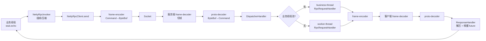
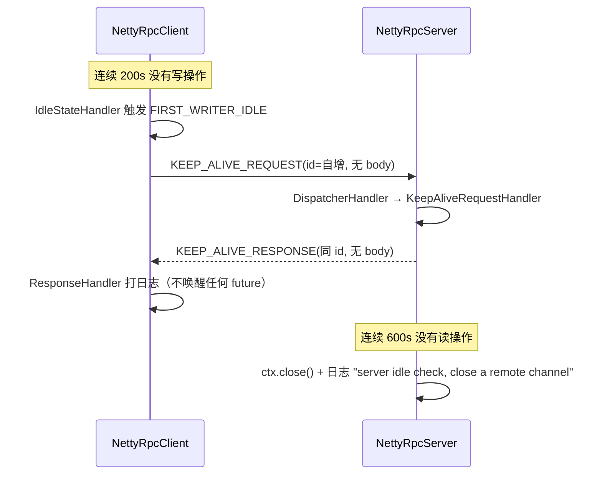
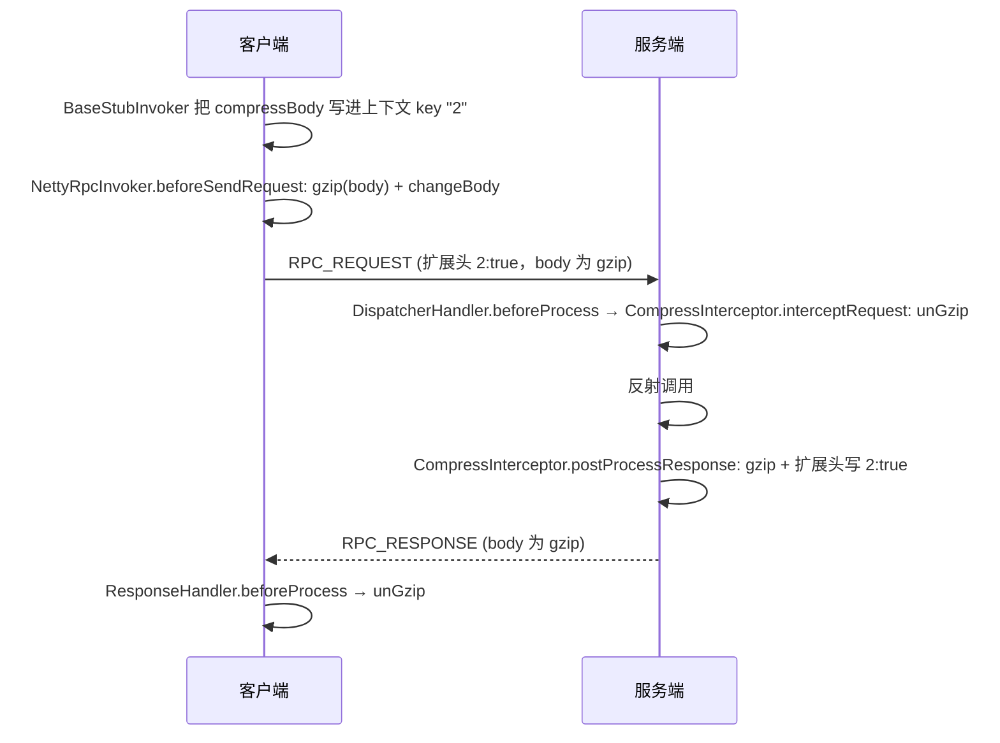
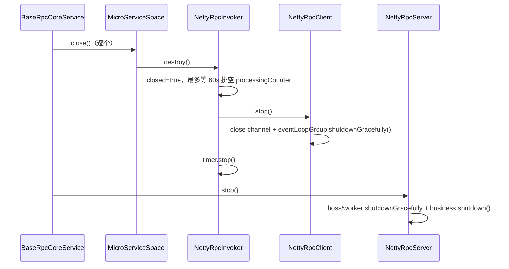

# Netty 传输层

> 网络通信模块第三篇，也是整个框架的「地基」：**Netty 的线程、Pipeline、连接、心跳、超时、压缩分别是怎么搭起来的**。帧格式见 [通信协议](./04-protocol.md)，业务语义见 [调用链路](./05-invocation.md)。

## 边界

`tomato-rpc-netty` 只做四件事：

| 职责                 | 类                                            |
| -------------------- | --------------------------------------------- |
| 字节 ↔ `Command`     | `codec` 包                                    |
| 监听端口、收发数据   | `transport/server`、`transport/client`        |
| 一次调用的网络侧实现 | `invoker`、`router`、`interceptor`、`service` |
| 服务端请求分发的落地 | `transport/handler`                           |

它不关心「选哪个实例」（那是 core 的路由与负载均衡）、也不关心「实例列表从哪来」（那是 registry-zookeeper）。

```text
tomato-rpc-netty/src/main/java/org/tomato/study/rpc/netty/
├── codec/                    NettyFrameDecoder / NettyProtoDecoder / NettyFrameEncoder / NettyCommandCodec
├── transport/
│   ├── client/               NettyRpcClient / ChannelWrapper / NettyResponseHolder / NettyResponseFuture
│   ├── server/               NettyRpcServer
│   └── handler/              DispatcherHandler / RpcRequestHandler / KeepAliveRequestHandler
│                             ResponseHandler / KeepAliveHandler / ClientIdleCheckHandler / ServerIdleCheckHandler
├── invoker/                  NettyRpcInvoker / NettyRpcInvokerFactory
├── router/                   NettyMicroServiceSpace（含熔断包装实现）
├── interceptor/              CompressInterceptor
├── service/                  NettyRpcCoreService / NettyRpcCoreServiceFactory
└── utils/                    ConvertUtils（DTO → RpcRequestModel）
```

## 服务端

### 线程模型

[NettyRpcServer#doInit](../tomato-rpc-netty/src/main/java/org/tomato/study/rpc/netty/transport/server/NettyRpcServer.java) 创建三组线程：

| 线程池               | 线程名                       | 数量                     | 干什么                       |
| -------------------- | ---------------------------- | ------------------------ | ---------------------------- |
| `bossGroup`          | `rpc-server-boss-thread`     | 1                        | accept 新连接                |
| `workerGroup`        | `rpc-server-worker-thread`   | Netty 默认（`2 * CPU`）  | 读写 IO、走 Pipeline、编解码 |
| `businessThreadPool` | `rpc-server-business-thread` | `businessThreadPoolSize` | 执行业务方法                 |

业务线程池是**可选**的，开关来自配置而不是单独的字段：

```java
// BaseRpcCoreService 构造时
.useBusinessThreadPool(rpcConfig.businessThreadPoolSize() > 1)
```

即 `business-thread: 1`（默认）时，业务方法直接在 **worker 线程**上反射调用；`> 1` 才启用独立池：

```java
new ThreadPoolExecutor(size, size, 0, SECONDS,
    new ArrayBlockingQueue<>(5000),
    new DefaultThreadFactory("rpc-server-business-thread"),
    (r, executor) -> {
        Logger.DEFAULT.error("business thread pool is overload");
        new ThreadPoolExecutor.AbortPolicy().rejectedExecution(r, executor);
    });
```

### Bootstrap 参数

| 参数                       | 值                                                                      | 目的                     |
| -------------------------- | ----------------------------------------------------------------------- | ------------------------ |
| `group`                    | boss + worker                                                           | 主从 Reactor             |
| `channel`                  | `EpollServerSocketChannel`（Epoll 可用时）否则 `NioServerSocketChannel` | Linux 上走 epoll         |
| `option(SO_BACKLOG)`       | `10000`                                                                 | 提高 accept 队列容量     |
| `childOption(TCP_NODELAY)` | `true`                                                                  | 关闭 Nagle，降低小包延迟 |
| `childOption(ALLOCATOR)`   | `PooledByteBufAllocator.DEFAULT`                                        | 池化 ByteBuf，减少 GC    |

### Pipeline

每个新连接都会装同一条链路：

```text
inbound ──▶ ① idle-checker   ServerIdleCheckHandler(readerIdle)
            ② frame-decoder  NettyFrameDecoder   (LengthFieldBasedFrameDecoder)
            ③ proto-decoder  NettyProtoDecoder   (ByteBuf → Command，校验 magic/length)
            ④ dispatcher     DispatcherHandler   (按 CommandType 分发)
outbound ◀── ⑤ frame-encoder NettyFrameEncoder   (Command → ByteBuf)
```

| #   | Handler                  | 类型                                   | 关键行为                                                           |
| --- | ------------------------ | -------------------------------------- | ------------------------------------------------------------------ |
| ①   | `ServerIdleCheckHandler` | `IdleStateHandler`                     | 只开 `readerIdleTime`；触发 `FIRST_READER_IDLE` 直接 `ctx.close()` |
| ②   | `NettyFrameDecoder`      | `LengthFieldBasedFrameDecoder`         | 按 `length` 字段切出完整帧                                         |
| ③   | `NettyProtoDecoder`      | `MessageToMessageDecoder<ByteBuf>`     | 生成 `Command`；magic/长度异常时 `ctx.close()`                     |
| ④   | `DispatcherHandler`      | `SimpleChannelInboundHandler<Command>` | 查 `handlerMap`，可能切业务线程池                                  |
| ⑤   | `NettyFrameEncoder`      | `MessageToByteEncoder<Command>`        | 按协议写字节                                                       |

> Pipeline 里 outbound 顺序与注册顺序相反，但 `frame-encoder` 注册在 `dispatcher` 之前，所以 `dispatcher` 里 `ctx.writeAndFlush(command)` 会先经过 `frame-encoder`——这也是它能直接写 `Command` 的原因。

### 请求处理线程

```java
if (type == CommandType.RPC_REQUEST && businessExecutor != null) {
    businessExecutor.execute(() -> processRequest(ctx, msg, matchHandler));
    return;
}
processRequest(ctx, msg, matchHandler);
```

只有 `RPC_REQUEST` 会切池；`KEEP_ALIVE_REQUEST` 永远在 IO 线程处理（它只是组一个空响应，很快）。

### 启停

| 阶段      | 动作                                                                                                    |
| --------- | ------------------------------------------------------------------------------------------------------- |
| `init()`  | 建线程池、建 `ServerBootstrap`、装 `ChannelInitializer`（**此时不占端口**）                             |
| `start()` | `serverBootstrap.bind(port).sync()`                                                                     |
| `stop()`  | `bossGroup.shutdownGracefully()` + `workerGroup.shutdownGracefully()` + `businessThreadPool.shutdown()` |

`isClosed()` 以状态机为准：`state == STOP_FINISHED`。

## 客户端

### 线程模型与 Bootstrap

| 项        | 值                                                                   |
| --------- | -------------------------------------------------------------------- |
| 线程池    | 单个 `EventLoopGroup`，线程名 `rpc-client-worker-thread`，Epoll 优先 |
| `channel` | `EpollSocketChannel` / `NioSocketChannel`                            |
| `option`  | `TCP_NODELAY = true`、`PooledByteBufAllocator.DEFAULT`               |
| 连接超时  | `CONNECTION_TIMEOUT_MS = 10000`（`connectFuture.await`）             |

### Pipeline

```text
inbound ──▶ ① client-idle-checker  ClientIdleCheckHandler(writerIdle = keepAliveMs)
            ② frame-decoder        NettyFrameDecoder
            ③ proto-decoder        NettyProtoDecoder
            ④ keep-alive-handler   KeepAliveHandler
            ⑤ response-handler     ResponseHandler
outbound ◀── ⑥ frame-encoder       NettyFrameEncoder
```

| #   | Handler                  | 关键行为                                                                        |
| --- | ------------------------ | ------------------------------------------------------------------------------- |
| ①   | `ClientIdleCheckHandler` | 只开 `writerIdleTime`，**不检测读空闲**                                         |
| ④   | `KeepAliveHandler`       | 收到 `FIRST_WRITER_IDLE_STATE_EVENT` 就发 `KEEP_ALIVE_REQUEST`                  |
| ⑤   | `ResponseHandler`        | 先 `CompressInterceptor` 解压，再按 `RPC_RESPONSE` / `KEEP_ALIVE_RESPONSE` 分支 |

### 连接管理

**一个服务实例 = 一个 `NettyRpcInvoker` = 一个 `NettyRpcClient` = 一条 TCP 长连接**，没有连接池、没有多路复用连接数上限（同一连接上靠 `messageId` 复用）。

```java
public ChannelWrapper createOrReconnect() throws InterruptedException, TimeoutException {
    if (channelWrapper == null || !channelWrapper.isActiveChannel()) {
        synchronized (this) {                                   // 双检锁
            if (channelWrapper == null || !channelWrapper.isActiveChannel()) {
                channelWrapper = createChannel(getHost(), getPort());
            }
        }
    }
    return channelWrapper;
}
```

| 特性     | 说明                                                                                  |
| -------- | ------------------------------------------------------------------------------------- |
| 懒连接   | 构造 `NettyRpcClient` 时只建 `Bootstrap`，第一次 `send` 才真正 `connect`              |
| 自动重连 | 每次 `send` 都调 `createOrReconnect()`，发现 channel 不活跃就重建                     |
| 连接失败 | `await(10s)` 超时抛 `RPC_CONNECTION_TIMEOUT`；连上但立刻不可用抛 `RPC_INVOKER_CLOSED` |
| 无重试   | 建连失败直接向上抛，不重试也不切换实例（切换实例是下一次调用的路由决策）              |

### 发送

```java
Channel connection = createOrReconnect().getChannel();
connection.writeAndFlush(msg).addListener((ChannelFutureListener) futureChannel -> {
    if (futureChannel.isSuccess()) {
        responseHolder.putFeatureResponse(id, future);
    } else {
        future.completeExceptionally(new TomatoRpcRuntimeException(futureChannel.cause(), NETTY_CLIENT_RPC_ERROR));
    }
});
```

`NettyResponseHolder` 是一张 `messageId → NettyResponseFuture` 的 `ConcurrentHashMap`，`getAndRemove` 保证「一次响应只唤醒一次」，响应与超时两条路径互斥。

> 已知竞态：future 是**写成功后**才登记。若服务端回包早于监听器回调（本地回环、极端小包），`ResponseHandler` 会因 `getAndRemove` 返回空而丢弃，调用方只能等超时。修复方式是把 `putFeatureResponse` 提前到 `writeAndFlush` 之前、失败时再 `remove`。

## 一次读写的完整路径



## 心跳与空闲检测

| 参数                          | 默认值                           | 作用点                                         |
| ----------------------------- | -------------------------------- | ---------------------------------------------- |
| `serverIdleCheckMilliseconds` | `600000`（10 分钟）              | 服务端 `ServerIdleCheckHandler.readerIdleTime` |
| `clientKeepAliveMilliseconds` | `serverIdleCheck / 3` = `200000` | 客户端 `ClientIdleCheckHandler.writerIdleTime` |

默认值 1:3 的比例不是装饰：客户端必须比服务端更早触发，否则服务端会先把「安静」的连接关掉。



几个容易忽略的点：

1. 心跳包也走完整协议，`CommandFactory.request(null, serializer, EMPTY_MAP, KEEP_ALIVE_REQUEST)`，body 为空、无扩展头。
2. 心跳响应有独立 `id`，但客户端**不会**为它登记 future，所以 `ResponseHandler` 只打 `keep alive response received` 日志。
3. 服务端只检测「读空闲」，客户端只检测「写空闲」。因此**服务端假死（不再回包但仍保持连接）时，客户端不会主动断连**，只能靠调用超时暴露问题。
4. 业务流量本身会刷新 idle 计时器，所以高 QPS 下几乎不会发心跳。

## 超时体系

三层，互不替代：

| 层       | 值                                                                               | 触发者                                  | 表现                                       |
| -------- | -------------------------------------------------------------------------------- | --------------------------------------- | ------------------------------------------ |
| 建连超时 | 10s                                                                              | `NettyRpcClient#createChannel`          | `RPC_CONNECTION_TIMEOUT`，直接抛异常       |
| 调用超时 | `StubConfig.timeoutMs`（默认 5000）或 `globalClientTimeoutMilliseconds`（50000） | `NettyRpcInvoker` 的 `HashedWheelTimer` | future 异常完成 → `RPC_INVOCATION_TIMEOUT` |
| 等待兜底 | `Integer.MAX_VALUE` 秒                                                           | `NettyInvocationResult#getResultSync`   | 实际不会走到，除非 future 永不完成         |

时间轮的实现细节：

```java
private final HashedWheelTimer timer = new HashedWheelTimer(100, TimeUnit.MILLISECONDS);
```

- **每个 `NettyRpcInvoker` 一个时间轮**（不是一个客户端共享一个），实例多时时间轮线程也会变多。
- tick 100ms，意味着超时精度约 100ms 量级。
- 超时任务的优先级：扩展头 `TIMEOUT` → `RpcConfig.globalClientTimeoutMilliseconds`。
- 超时只清理**客户端 future**，不发取消帧、不关连接——服务端可能仍在执行这个请求。

## 压缩

压缩是**按 stub 开关 + 帧头标记**的端到端协商，不是连接级协商：



| 细节     | 现状                                                                                                                                             |
| -------- | ------------------------------------------------------------------------------------------------------------------------------------------------ |
| 阈值     | 无。只要 `compressBody=true` 就压缩，小包反而变大                                                                                                |
| 算法     | GZIP（`GzipUtils`，`ByteArrayOutputStream` + `GZIPOutputStream`，必须 `close` 才有结束符）                                                       |
| 标记同步 | 压缩后一律通过 `CommandFactory.changeBody` 修正 `length`；服务端压缩响应时额外用 `ExtensionHeaderBuilder` 写入 `2:true` 并同步 `extensionLength` |
| 空 body  | 直接跳过，不压缩                                                                                                                                 |

## 背压与过载

框架没有真正的背压，只有「拒绝 + 让调用方超时」：

| 环节         | 行为                                                                                                   |
| ------------ | ------------------------------------------------------------------------------------------------------ |
| 业务线程池   | 队列 `ArrayBlockingQueue(5000)`；满了抛 `AbortPolicy`，日志 `business thread pool is overload`         |
| 拒绝后的响应 | 没有响应。异常在 worker 线程抛出，`DispatcherHandler#exceptionCaught` 只打日志（服务端版本不 `close`） |
| 客户端观感   | 调用超时（`RPC_INVOCATION_TIMEOUT`），且该请求可能已经进入队列但未执行                                 |
| 写侧水位     | 无。`writeAndFlush` 不做 `isWritable()` 判断，极端情况下可能堆积在 channel 出站缓冲                    |

## 关闭



`shutdownGracefully()` 使用 Netty 默认的 quiet period / timeout，期间的剩余任务会被执行完；`businessThreadPool.shutdown()` 则不再接收新任务。

## 可观测性

| 日志                                          | 级别            | 内容                              |
| --------------------------------------------- | --------------- | --------------------------------- |
| `sent keep alive packet`                      | info            | 客户端心跳发送                    |
| `keep alive response received`                | info            | 心跳响应                          |
| `server idle check, close a remote channel`   | info            | 服务端关闭空闲连接                |
| `rpc timeout, message id: {}, invocation: {}` | warn            | 时间轮超时                        |
| `business thread pool is overload`            | error           | 业务池打满                        |
| `decode command error`                        | error           | 解码失败（随后断连）              |
| `rpc handle failed`                           | error           | 服务端处理异常（会回错误响应）    |
| `\|refresh-router\|Y/N\|耗时\|opsId\|`        | `Logger.DIGEST` | 路由刷新摘要（在 core，非 netty） |

`Logger` 是枚举门面（[common/utils](../tomato-rpc-common/src/main/java/org/tomato/study/rpc/common/utils/Logger.java)），`DEFAULT` 对应业务日志，`DIGEST` 对应摘要日志，可用 log4j2 分开输出。

## 已知问题与改进方向

| #   | 问题                      | 影响                         | 建议                                                               |
| --- | ------------------------- | ---------------------------- | ------------------------------------------------------------------ |
| 1   | future 登记晚于写出       | 极快响应可能被丢弃 → 超时    | 先登记再写，失败时回滚                                             |
| 2   | 无 `channelInactive` 清理 | 断连时在途 future 只能等超时 | 在 `ResponseHandler` 加 `channelInactive`，批量失败该连接的 future |
| 3   | 时间轮 per invoker        | 实例多时线程数随实例线性增长 | 改为 `NettyRpcInvokerFactory` 级共享时间轮                         |
| 4   | 压缩无阈值                | 小包压缩后更大               | 按 body 长度阈值决定是否压缩                                       |
| 5   | 无 TLS / 无鉴权           | 明文传输                     | 加 `SslHandler` 与服务端认证扩展点                                 |
| 6   | 服务端拒绝无回包          | 客户端只能超时               | 拒绝时回一个 `TOO_MANY_REQUEST` 响应                               |
| 7   | `version` 不校验          | 协议演进期易静默错解析       | 解码时做版本白名单                                                 |
| 8   | 客户端不检测读空闲        | 服务端假死难以及时发现       | 增加 `readerIdle` + 主动重连                                       |

## 调优参数速查

| 参数                   | 位置                              | 默认                | 调大 / 调小的影响                          |
| ---------------------- | --------------------------------- | ------------------- | ------------------------------------------ |
| `business-thread`      | `tomato-rpc.business-thread`      | `1`（不启用业务池） | 调大：业务与 IO 隔离；注意 `> 1` 才生效    |
| 业务队列               | 硬编码 `ArrayBlockingQueue(5000)` | 5000                | 调大：抗突发更强，但延迟更高、超时风险更大 |
| `server-idle-check-ms` | 配置                              | 600000              | 调小：更快回收死连接，心跳更频繁           |
| `client-keep-alive-ms` | 配置                              | `serverIdle / 3`    | 必须小于服务端空闲阈值                     |
| `SO_BACKLOG`           | 硬编码                            | 10000               | 高并发建连时才需要关注                     |
| 时间轮 tick            | 硬编码                            | 100ms               | 影响超时精度与 CPU                         |
| `timeout`              | `@RpcClientStub` / `StubConfig`   | 5000 / 50000        | 应根据 P99 设置，别用默认值赌              |

## 关键类速查

| 类                                                  | 位置                                                                                                                             | 职责                                         |
| --------------------------------------------------- | -------------------------------------------------------------------------------------------------------------------------------- | -------------------------------------------- |
| `NettyRpcServer`                                    | [netty/transport/server](../tomato-rpc-netty/src/main/java/org/tomato/study/rpc/netty/transport/server/NettyRpcServer.java)      | 三线程池 + ServerBootstrap + 服务端 Pipeline |
| `NettyRpcClient`                                    | [netty/transport/client](../tomato-rpc-netty/src/main/java/org/tomato/study/rpc/netty/transport/client/NettyRpcClient.java)      | 客户端 Bootstrap、连接复用与重连、发送       |
| `ChannelWrapper`                                    | [netty/transport/client](../tomato-rpc-netty/src/main/java/org/tomato/study/rpc/netty/transport/client/ChannelWrapper.java)      | channel 活跃性判断与关闭                     |
| `NettyResponseHolder` / `NettyResponseFuture`       | [netty/transport/client](../tomato-rpc-netty/src/main/java/org/tomato/study/rpc/netty/transport/client/)                         | id → future 映射                             |
| `DispatcherHandler`                                 | [netty/transport/handler](../tomato-rpc-netty/src/main/java/org/tomato/study/rpc/netty/transport/handler/DispatcherHandler.java) | 服务端分发、执行器切换、上下文/MDC           |
| `ResponseHandler`                                   | [netty/transport/handler](../tomato-rpc-netty/src/main/java/org/tomato/study/rpc/netty/transport/handler/ResponseHandler.java)   | 客户端响应处理                               |
| `KeepAliveHandler` / `KeepAliveRequestHandler`      | [netty/transport/handler](../tomato-rpc-netty/src/main/java/org/tomato/study/rpc/netty/transport/handler/)                       | 心跳发送 / 回应                              |
| `ClientIdleCheckHandler` / `ServerIdleCheckHandler` | [netty/transport/handler](../tomato-rpc-netty/src/main/java/org/tomato/study/rpc/netty/transport/handler/)                       | 写空闲 / 读空闲检测                          |
| `CompressInterceptor`                               | [netty/interceptor](../tomato-rpc-netty/src/main/java/org/tomato/study/rpc/netty/interceptor/CompressInterceptor.java)           | 请求解压、响应压缩                           |
| `NettyRpcInvoker`                                   | [netty/invoker](../tomato-rpc-netty/src/main/java/org/tomato/study/rpc/netty/invoker/NettyRpcInvoker.java)                       | 组帧、压缩、超时                             |
| `NettyRpcCoreService`                               | [netty/service](../tomato-rpc-netty/src/main/java/org/tomato/study/rpc/netty/service/NettyRpcCoreService.java)                   | 把 netty 实现装配进 core 抽象                |
