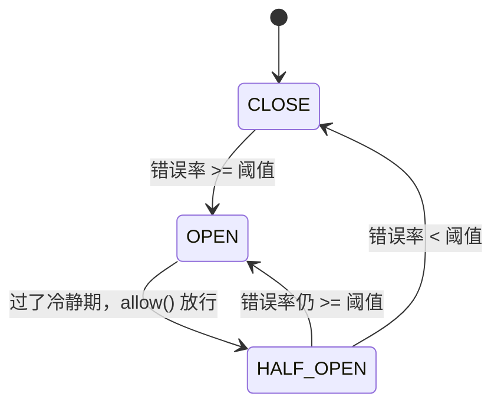

# 服务治理

治理能力都在 core，与具体传输无关。一次调用能被「导流」，靠的是三个开关叠加：

```text
订阅阶段：stage → 决定从哪个环境的 ZK 目录取实例
路由阶段：表达式 → 从实例集合里筛出候选（含兜底规则）
选择阶段：平滑加权轮询 → 从候选里挑一个
熔断阶段：按 apiId 统计错误率 → 必要时直接失败，不发起网络请求
```

## 能力总览

| 能力             | 粒度                     | 配置入口                                                                                   | 实现                      |
| ---------------- | ------------------------ | ------------------------------------------------------------------------------------------ | ------------------------- |
| 环境隔离         | micro-service-id + stage | `tomato-rpc.stage` / `-Dtomato-rpc.service-stage`                                          | ZK 路径分段               |
| 分组隔离（灰度） | group                    | `tomato-rpc.group`、`-Dtomato-rpc.service-group`、`-Dtomato-rpc.subscribed-services-group` | 兜底路由表达式            |
| 表达式路由       | 请求属性 + 实例属性      | dashboard 下发                                                                             | `ExprRouter` + 表达式引擎 |
| 负载均衡         | apiId                    | SPI 换实现                                                                                 | `RoundRobinLoadBalance`   |
| 节点权重         | 实例                     | `MetaData.NodeProperty.weight`                                                             | 平滑加权轮询              |
| 熔断             | apiId                    | `tomato-rpc.enable-circuit` 等                                                             | `DefaultCircuitBreaker`   |

## stage：物理隔离

`subscribe` 时用 **自己的 stage** 拼路径去读别人的实例：

```java
String targetPath = ZookeeperAssembler.buildServiceNodeParent(microServiceId, stage);
```

所以 `stage=dev` 的消费者永远看不到 `stage=prod` 的提供者，隔离发生在 ZK 目录这一层，不依赖任何过滤逻辑。

优先级：**JVM 参数 > 配置文件**。

```java
// BaseRpcCoreService#getStage
String stage = System.getProperty(RpcJvmConfigKey.MICRO_SERVICE_STAGE);  // tomato-rpc.service-stage
return stage != null ? stage : rpcConfig.stage();
```

样例用这个机制在一个进程里演示多环境：`spring-sample-server` 同时有 `application-dev/gray/prod`，启动时用 `-Dtomato-rpc.service-stage=gray` 决定自己是哪套环境。

## group：靠兜底路由实现

框架没有为 group 写专门的过滤器，而是把它变成一条**永远存在的路由规则**：

```java
// BaseMicroServiceSpace#initDefaultRouters
String defaultExpression = String.format("""
    %s=="%s"
    """, MetaData.GROUP_PARAM_NAME, finalGroup);      // group=="main"
this.defaultRouters = Collections.singletonList(new FullRequestRouter(defaultExpression, node));
```

| 环节              | 规则                                                                                                                             |
| ----------------- | -------------------------------------------------------------------------------------------------------------------------------- |
| `finalGroup` 取值 | 先看 `-Dtomato-rpc.subscribed-services-group` 里有没有针对该下游的配置（格式 `服务id:组名&服务id2:组名2`），否则用自身的 `group` |
| 生效时机          | 订阅时 `refreshRouter(0, ...)` 会把兜底规则追加到规则列表**末尾**                                                                |
| 匹配方式          | 请求侧恒为真（`FullRequestRouter`），实例侧 `group == finalGroup`                                                                |

于是「同组优先，没有同组则失败」是默认行为；要让某个下游走灰度，只需给这个下游单独指定组：

```bash
-Dtomato-rpc.subscribed-services-group=demo-rpc-service:gray
```

> `StubConfig.group` / `BaseStubInvoker.group` 已经标了 `@Deprecated`，group 的选择统一收敛到 `MicroServiceSpace` 的兜底路由，避免「同一个下游不同 stub 用不同组」的混乱。

## 表达式路由

### 规则形态

```text
<请求侧表达式> -> <实例侧表达式>
```

示例（来自集成测试 `RpcExecutionChainTest`）：

```text
USER_ID % 10 == 2 -> group == "gray"
```

| 部分     | 求值上下文                                               | 可用变量                                  |
| -------- | -------------------------------------------------------- | ----------------------------------------- |
| 左表达式 | 当前线程的 `InvocationContext`（即扩展头里的键值）       | `USER_ID`、`TRACE_ID`、任意业务塞进去的键 |
| 右表达式 | `RpcInvoker#getInvokerPropertyMap()`（`MetaData#toMap`） | `group`、`weight`                         |

### 语法与实现

支持：`+ - * / %`、`== != > >= < <=`、`&& || !`（以及 `and/or/not` 形式的关键字，由词法层处理）、括号、字符串字面量。实现是经典的「状态机词法 + 递归下降」：

```text
TokenLexer（状态机）
  → TokenStream
  → RootExpressionParser
      → LogicParser
          → CmpParser
              → AddAndSubParser
                  → MulAndDivAndModParser
                      → PrimaryTokenParser（数字/字符串/变量/括号，括号会回到 Root）
  → ASTNode#calc(ExpressionCalcContext) → "true"/"false"/数值/字符串
```

`BaseMicroServiceSpace` 用静态初始化把这条链装好，`refreshRouter` 时每条规则只解析一次，之后每次调用只做 AST 求值。

### 生效顺序

```java
for (Router router : routers) {
    if (!router.matchRequest(context)) continue;         // 这单归不归我管
    for (RpcInvoker invoker : allInvokers) {
        if (router.matchInvoker(invoker)) invokers.add(invoker);
    }
    if (!invokers.isEmpty()) break;                      // 首个命中即停
}
```

三条规则：

1. **顺序即优先级**：列表顺序就是求值顺序；`ExprRouter` 的 `priority = i + 1` 只是记录末位，真正的排序发生在 `MonitorController` 收到 dashboard 请求时（见 [监控与运营](./11-dashboard.md)）。
2. **首个有候选的规则独占**：命中后不再尝试后面的规则，也不会把多个规则的候选并集。
3. **兜底规则永远最后**：`refreshRouter` 里 `newRouters.addAll(defaultRouters)`。

排查时容易误判的一点：一条规则写错（比如右表达式永远为假）**不会**把请求“卡死”在这条规则上。`lookUp` 的 `break` 只在候选非空时执行，所以这条规则命中却筛不出实例时，循环会继续往后走到后面的规则、最终走到兜底规则。真正的失败只有一种：**所有规则都筛不出候选**，此时 `lookUp` 返回 `Optional.empty()`，客户端收到 `STUB_INVOKER_SEARCH_ERROR`。

### 版本号防回退

```java
if (routerOpsGlobalId <= this.routerOpsGlobalId) {
    Logger.DEFAULT.warn("routerOpsGlobalId in mem is {}, not less than {}", ...);
    return;
}
```

dashboard 每次操作都会生成一个递增的 `opsGlobalId`，客户端只会接受更大的版本号，防止乱序推送把规则回滚。

## 负载均衡：平滑加权轮询

`RoundRobinLoadBalance` 为**每个 apiId** 维护一张 `MetaData → NodeWeight` 表（`currentWeight` 是 `AtomicLong`）：

```java
for (RpcInvoker invoker : invokers) {
    NodeWeight nodeWeight = serviceWeightMap.computeIfAbsent(metadata, k -> new NodeWeight(metadata.getWeight()));
    sum += nodeWeight.weight;
    long currentWeight = nodeWeight.addWeightAndGet();     // current += weight
    if (currentWeight > currentMaxWeight) { target = invoker; selected = nodeWeight; }
}
selected.subWeightSum(sum);                                 // current -= sum
```

以 A(weight=2)、B(weight=1) 为例（初始 current 均为 0）：

| 轮次 | A.current | B.current | 选中 | 调整后 A / B |
| ---- | --------- | --------- | ---- | ------------ |
| 1    | 2         | 1         | A    | -1 / 1       |
| 2    | 1         | 2         | B    | 1 / -1       |
| 3    | 3         | 0         | A    | 0 / 0        |

序列为 `A B A`，并且三次一轮回到初始状态——这就是「平滑」的含义：不会出现 `A A B` 这种突发。

| 细节       | 说明                                                                                      |
| ---------- | ----------------------------------------------------------------------------------------- |
| 单实例短路 | `BaseLoadBalance#select` 在候选只有 1 个时直接返回，不走算法                              |
| 空候选     | 返回 `null`，上层转成 `invoker not found`                                                 |
| 权重来源   | `MetaData.getWeight()`，即实例 URL 里的 `property=weight:1`                               |
| 并发安全   | `currentWeight` 原子自增，但「求最大值 + 减总和」不是原子的，高并发下权重分布会有轻微抖动 |
| 内存       | `weightMap` 只增不减（key 是 apiId），api 很多时需要注意                                  |

## 熔断

### 三态机



| 状态        | `allow()` 返回                                   | 说明                                             |
| ----------- | ------------------------------------------------ | ------------------------------------------------ |
| `CLOSE`     | true                                             | 正常放行                                         |
| `OPEN`      | 冷静期内 false；到期后 CAS 成 `HALF_OPEN` 并放行 | 冷静期 `circuitOpenSeconds`（默认 60s）          |
| `HALF_OPEN` | true                                             | 放行探测流量，按结果决定回 `CLOSE` 还是回 `OPEN` |

### 计数窗口

`SuccessFailureRingCounter` 用 `BitSet` + 树状数组（`FenwickTree`）实现一个定长环：

```text
BitSet：每个 bit 代表窗口里的一个「坑」，1=成功 0=失败
FenwickTree：对 BitSet 做前缀和，O(log n) 得到成功数
failureSum = size - successSum
错误率 = failureSum / size
```

关键点：

- 每个坑只翻转一次（成功→失败或失败→成功），不是「每次调用都记一条」；`next()` 循环推进下标。
- 初始时所有坑都被置为成功（构造器里循环 `addSuccess()`），所以**窗口里没有历史流量时错误率是 0**，不会一启动就误熔断。
- 错误率的分母是**窗口大小**而不是「已采样次数」。这意味着 `circuitOpenRate=0.75, circuitWindow=10000` 时，需要窗口里累计 7500 个失败坑才会熔断——低流量场景下几乎熔不断，高流量场景下反应会偏慢。

### 包装位置

```java
// BaseMicroServiceSpace#createInvoker
RpcInvoker rpcInvoker = doCreateInvoker(metaData);
return rpcConfig.enableCircuit() ? doCreateCircuitBreaker(rpcInvoker) : rpcInvoker;
```

| 特性           | 说明                                                                             |
| -------------- | -------------------------------------------------------------------------------- |
| 粒度           | `apiId = microServiceId$interfaceName$methodName`，一个实例 × 一个方法一个断路器 |
| 同步失败       | `invoke` 抛异常时立即 `addFailure()`                                             |
| 异步结果       | `getResultAsync().handleAsync(...)` 回调里按 `Response.code` 判定成功/失败       |
| 熔断打开时     | `CircuitRpcInvoker` 抛 `RPC_CIRCUIT_ERROR`，**不会走网络**                       |
| 超时是否算失败 | 算。超时在 `NettyInvocationResult` 里被转成错误码响应，`doHandle` 会记失败       |

## 配置项

| 键                                       | 默认          | 说明                   |
| ---------------------------------------- | ------------- | ---------------------- |
| `tomato-rpc.stage`                       | `default`     | 环境                   |
| `tomato-rpc.group`                       | `default`     | 自身分组               |
| `-Dtomato-rpc.service-stage`             | —             | JVM 级覆盖环境         |
| `-Dtomato-rpc.service-group`             | —             | JVM 级覆盖分组         |
| `-Dtomato-rpc.subscribed-services-group` | —             | 按下游指定分组（灰度） |
| `tomato-rpc.enable-circuit`              | false         | 是否启用熔断           |
| `tomato-rpc.circuit-open-rate`           | 75（%）→ 0.75 | 触发熔断的错误率       |
| `tomato-rpc.circuit-open-seconds`        | 60            | 冷静期                 |
| `tomato-rpc.circuit-window`              | 10000         | 计数窗口               |

## 已知限制

| #   | 限制                                                                                                                                       |
| --- | ------------------------------------------------------------------------------------------------------------------------------------------ |
| 1   | 路由规则变更只能通过 dashboard 主动推送，ZK 里的 `routers` 数据变了不会自动生效                                                            |
| 2   | `ExprRouter.priority` 在 `BaseMicroServiceSpace` 内不参与排序（按列表顺序遍历）；顺序由 `MonitorController` 在下发前按 `priority` 排序保证 |
| 3   | 只改权重不会刷新 invoker（`MetaData.equals` 忽略 `nodeProperty`），见 [注册中心](./07-registry-zookeeper.md#实例列表如何变成-invoker)      |
| 4   | 熔断窗口分母固定为 `size`，低流量下难触发                                                                                                  |
| 5   | `CircuitRpcInvoker#doHandle` 先取 `response.getCode()` 再判 `exception`；当前依赖 `getResultAsync` 把异常转成错误响应才不会 NPE            |
| 6   | 负载均衡表按 apiId 无过期清理                                                                                                              |

## 关键类速查

| 类                                 | 位置                                                                                                                  | 职责                           |
| ---------------------------------- | --------------------------------------------------------------------------------------------------------------------- | ------------------------------ |
| `BaseMicroServiceSpace`            | [core/router](../tomato-rpc-core/src/main/java/org/tomato/study/rpc/core/router/BaseMicroServiceSpace.java)           | 路由 + 均衡 + 熔断包装的总调度 |
| `FullRequestRouter` / `ExprRouter` | [core/router](../tomato-rpc-core/src/main/java/org/tomato/study/rpc/core/router/)                                     | 兜底规则 / 表达式规则          |
| `RoundRobinLoadBalance`            | [core/loadbalance](../tomato-rpc-core/src/main/java/org/tomato/study/rpc/core/loadbalance/RoundRobinLoadBalance.java) | 平滑加权轮询                   |
| `DefaultCircuitBreaker`            | [core/circuit](../tomato-rpc-core/src/main/java/org/tomato/study/rpc/core/circuit/DefaultCircuitBreaker.java)         | 三态机                         |
| `SuccessFailureRingCounter`        | [core/circuit](../tomato-rpc-core/src/main/java/org/tomato/study/rpc/core/circuit/SuccessFailureRingCounter.java)     | BitSet + FenwickTree 计数窗口  |
| `CircuitRpcInvoker`                | [core/circuit](../tomato-rpc-core/src/main/java/org/tomato/study/rpc/core/circuit/CircuitRpcInvoker.java)             | invoker 包装器                 |
| `FenwickTree`                      | [common/structure](../tomato-rpc-common/src/main/java/org/tomato/study/rpc/common/structure/FenwickTree.java)         | 前缀和                         |
| `ExpressionParser` 系列            | [expression/ast](../tomato-rpc-expression/src/main/java/org/tomato/study/rpc/expression/ast/)                         | 表达式解析与 AST               |
