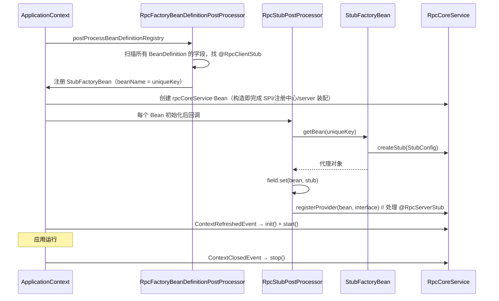

# Spring 集成

`tomato-rpc-config` 把框架包成 Spring Boot Starter 的样子：只引一个依赖、写几行 yaml、加两个注解就能用。

## 自动装配入口

两份配置同时存在，兼容新旧 Spring Boot 版本：

```text
# META-INF/spring.factories
org.springframework.boot.autoconfigure.EnableAutoConfiguration=\
  org.tomato.study.rpc.config.component.TomatoRpcConfiguration

# META-INF/spring/org.springframework.boot.autoconfigure.AutoConfiguration.imports
org.tomato.study.rpc.config.component.TomatoRpcConfiguration
```

`TomatoRpcConfiguration` 上的三个注解决定了它的能力：

```java
@Configuration
@Import(RpcFactoryBeanDefinitionPostProcessor.class)          // 提前注册 stub 的 BeanDefinition
@EnableConfigurationProperties({TomatoRpcProperties.class})  // 绑定 tomato-rpc.*
@Role(BeanDefinition.ROLE_INFRASTRUCTURE)
```

`tomato-rpc-spring-boot-starter` 是一个空壳，只做 `dependency` 聚合：

```xml
<dependency><artifactId>tomato-rpc-config</artifactId></dependency>
```

## 装配时序



几个关键点：

| 点                                             | 说明                                                                                                                             |
| ---------------------------------------------- | -------------------------------------------------------------------------------------------------------------------------------- |
| 为什么用 `BeanDefinitionRegistryPostProcessor` | 要在 Bean 实例化**之前**把 `StubFactoryBean` 注册进容器，之后才能按名字 `getBean`                                                |
| Bean 名                                        | `ClientStubMetadata#uniqueKey()` = `接口全名_microServiceId_timeout_group_compressBody`，因此同一接口不同配置会生成**多个** bean |
| 字段注入时机                                   | `postProcessAfterInitialization`，此时 `rpcCoreService` Bean 已存在但**还没 start**                                              |
| 为什么此时创建 stub 不报错                     | `createStub` 只创建代理和 `StubInvoker`，不发网络请求；只有真正调用时才 `lookupInvoker`                                          |
| 去重                                           | 相同的 `ClientStubMetadata`（`equals` 覆盖了 `ClientStubMetadata` 自身字段）只注册一次                                           |
| 父类字段                                       | `while (clazz != Object.class)` 向上遍历父类，继承来的 `@RpcClientStub` 字段也能注入                                             |

## 注解

### `@RpcClientStub`

| 属性             | 默认    | 说明                                                                                                                            |
| ---------------- | ------- | ------------------------------------------------------------------------------------------------------------------------------- |
| `microServiceId` | 必填    | 目标服务                                                                                                                        |
| `timeout`        | `5000`  | 调用超时 ms，写入扩展头 `1`                                                                                                     |
| `group`          | `""`    | 为空时用 `rpcCoreService.getGroup()`；指定后会写进 `StubConfig.group`（该字段已标记 `@Deprecated`，分组选择实际由兜底路由决定） |
| `compressBody`   | `false` | 是否 gzip 请求体                                                                                                                |

注解只能标在**字段**上，不支持构造器注入或 `@Autowired` 语义。

### `@RpcServerStub`

| 属性             | 默认 | 说明                                                                       |
| ---------------- | ---- | -------------------------------------------------------------------------- |
| `interfaceTypes` | `{}` | 为空时自动向上找第一个 `getInterfaces()`；一个类实现多个接口时必须显式指定 |

它本身带 `@Component`，所以被标注的类会被 Spring 扫描为 Bean，然后由 `RpcStubPostProcessor` 注册为 provider。

## 配置项

`TomatoRpcProperties`（`prefix = "tomato-rpc"`）的全部字段：

| yaml 键                | 字段                 | 类型         | 默认           | 说明                          |
| ---------------------- | -------------------- | ------------ | -------------- | ----------------------------- |
| `micro-service-id`     | `microServiceId`     | String       | 无（必填）     | 服务唯一标识                  |
| `subscribed-services`  | `subscribedServices` | List<String> | 空             | 要订阅的服务 id               |
| `name-service-uri`     | `nameServiceUri`     | String       | 无             | ZK 地址，如 `127.0.0.1:2181`  |
| `port`                 | `port`               | Integer      | `9090`         | **RPC 端口**，不是 HTTP 端口  |
| `business-thread`      | `businessThread`     | Integer      | `1`            | `> 1` 才启用业务线程池        |
| `stage`                | `stage`              | String       | `default`      | 环境                          |
| `group`                | `group`              | String       | `default`      | 分组                          |
| `server-idle-check-ms` | `serverIdleCheckMs`  | Long         | `600000`       | 服务端读空闲阈值              |
| `client-keep-alive-ms` | `clientKeepAliveMs`  | Long         | `serverIdle/3` | 客户端心跳间隔                |
| `enable-circuit`       | `enableCircuit`      | boolean      | `false`        | 是否启用熔断                  |
| `circuit-open-rate`    | `circuitOpenRate`    | Integer      | `75`           | **百分比**，配置层会 `/100.0` |
| `circuit-open-seconds` | `circuitOpenSeconds` | Long         | `60`           | 冷静期                        |
| `circuit-window`       | `circuitWindow`      | Integer      | `10000`        | 采样窗口                      |

几个容易踩的点：

1. **`circuit-open-rate` 是百分数**：`TomatoRpcConfiguration` 里做 `properties.getCircuitOpenRate() / 100.0`，所以 yaml 写 `50` 表示 50%。
2. **熔断参数只在 `enable-circuit=true` 时生效**：其余三项被包在同一个 `if` 里，关闭熔断时即使配了也不会写进 `RpcConfig`。
3. **JVM 覆盖只覆盖两项**：`group` 与 `nameServiceUri` 在 `TomatoRpcConfiguration` 里用 `System.getProperty` 兜底；`stage` 不在这里覆盖，而是在 `BaseRpcCoreService#getStage` 里覆盖。
4. **`use-gzip` 之类的属性不存在**：`TomatoRpcProperties` 没有该字段，Spring 默认忽略未知属性（`ignoreUnknownFields=true`），所以写了也不报错但完全无效。压缩只能通过 `@RpcClientStub(compressBody = true)` 或 `StubConfig` 控制。
5. `subscribed-services` 的字段名是 `subscribedServices`，yaml 用 kebab-case 才能绑定。

## 生命周期挂载点

```java
@EventListener
public void onApplicationEvent(ContextRefreshedEvent event) {
    RpcCoreService rpcCoreService = event.getApplicationContext().getBean(RpcCoreService.class);
    rpcCoreService.init();
    rpcCoreService.start();
}

@EventListener
public void onApplicationEvent(ContextClosedEvent event) {
    event.getApplicationContext().getBean(RpcCoreService.class).stop();
}
```

选择 `ContextRefreshedEvent` 而不是 `@PostConstruct` 的原因：必须等**所有** Bean（尤其是 provider 实现类）都初始化完，才能安全地 `registerProvider` 与订阅下游。

副作用：如果应用里有多个 `ApplicationContext`（比如 Spring Cloud 的子容器），`ContextRefreshedEvent` 会触发多次；由于状态机 CAS 幂等，重复调用是安全的。

## 本地监控接口

`MonitorController` 是一个 `record` 形式的 `@RestController`，路径常量集中在 [ApiUrl](../tomato-rpc-common/src/main/java/org/tomato/study/rpc/common/monitor/ApiUrl.java)：

| 方法 | 路径                               | 参数                   | 返回                                    |
| ---- | ---------------------------------- | ---------------------- | --------------------------------------- |
| GET  | `/api/tomato/invoker/local/status` | `microServiceId`       | 按 stage → group 分组的实例列表         |
| GET  | `/api/tomato/invoker/local/ready`  | —                      | 就绪返回 200 空串，否则 503 `not ready` |
| GET  | `/api/tomato/router/local/list`    | `routerMicroServiceId` | 当前进程内存里的路由表达式列表          |
| POST | `/api/tomato/router/local/refresh` | `RouterRefreshDTO`     | 刷新本机路由规则                        |

这些接口跑在业务应用的 HTTP 端口上（不是 RPC 端口），dashboard 通过它们把规则推进来——注意 dashboard 侧把端口**硬编码成了 9090**，见 [监控与运营](./11-dashboard.md)。

## 多环境与灰度

样例用 Spring profile 演示两种玩法：

```yaml
# application-gray.yaml（客户端）
tomato-rpc:
  stage: "prod"
  group: "gray"
```

| 玩法               | 做法                                                                                     |
| ------------------ | ---------------------------------------------------------------------------------------- |
| 一个进程一个环境   | 不同 profile 配不同 `stage`/`group`/`port`                                               |
| 同一份代码多环境   | 启动参数 `-Dtomato-rpc.service-stage=gray -Dtomato-rpc.service-group=gray`，JVM 覆盖配置 |
| 只让某个下游走灰度 | `-Dtomato-rpc.subscribed-services-group=demo-rpc-service:gray`                           |

`tomato-rpc-spring-sample-server` 的多份 yaml（`application-dev/gray/prod`、`application-downstream-*`）就是为对比不同 stage 的注册结果准备的。

## 已知限制

| #   | 限制                                                                                      |
| --- | ----------------------------------------------------------------------------------------- |
| 1   | 不支持 `@RpcClientStub` 标在方法参数或构造器上                                            |
| 2   | 同一个接口在不同类里配置相同参数时共享一个 bean（这是特性，但也意味着无法按注入点区分）   |
| 3   | 未提供 `@ConditionalOnProperty` 之类的开关，引入 starter 就一定创建 `RpcCoreService` Bean |
| 4   | `rpcCoreService` Bean 创建失败会直接让应用启动失败（构造期装配）                          |
| 5   | 未知配置项被静默忽略，拼写错误难以发现                                                    |

## 关键类速查

| 类                                      | 位置                                                                                                                                    | 职责                                                   |
| --------------------------------------- | --------------------------------------------------------------------------------------------------------------------------------------- | ------------------------------------------------------ |
| `TomatoRpcConfiguration`                | [config/component](../tomato-rpc-config/src/main/java/org/tomato/study/rpc/config/component/TomatoRpcConfiguration.java)                | 装配 `RpcCoreService`、注册后置处理器与监控 Controller |
| `TomatoRpcProperties`                   | [config/data](../tomato-rpc-config/src/main/java/org/tomato/study/rpc/config/data/TomatoRpcProperties.java)                             | `tomato-rpc.*` 绑定                                    |
| `RpcFactoryBeanDefinitionPostProcessor` | [config/component](../tomato-rpc-config/src/main/java/org/tomato/study/rpc/config/component/RpcFactoryBeanDefinitionPostProcessor.java) | 扫描注解、注册 `StubFactoryBean`                       |
| `RpcStubPostProcessor`                  | [config/component](../tomato-rpc-config/src/main/java/org/tomato/study/rpc/config/component/RpcStubPostProcessor.java)                  | 字段注入 stub、注册 provider                           |
| `StubFactoryBean`                       | [config/component](../tomato-rpc-config/src/main/java/org/tomato/study/rpc/config/component/StubFactoryBean.java)                       | 把 `ClientStubMetadata` 变成代理对象                   |
| `ClientStubMetadata`                    | [config/data](../tomato-rpc-config/src/main/java/org/tomato/study/rpc/config/data/ClientStubMetadata.java)                              | 注解元数据 + `uniqueKey`                               |
| `MonitorController`                     | [config/controller](../tomato-rpc-config/src/main/java/org/tomato/study/rpc/config/controller/MonitorController.java)                   | 本机监控与路由刷新接口                                 |
