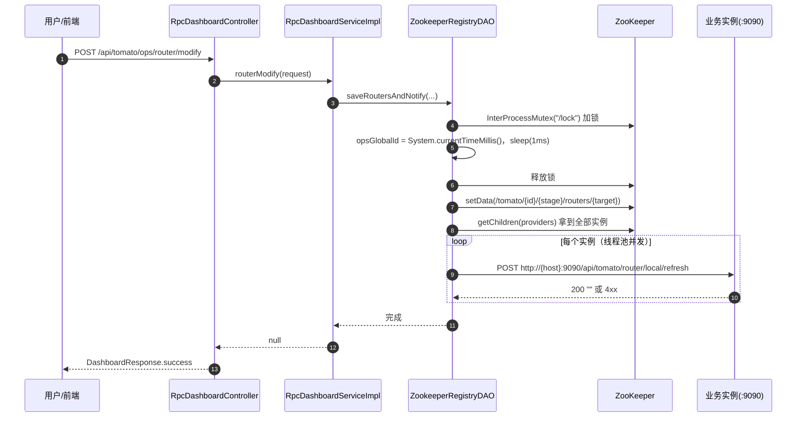

# 监控与运营（dashboard）

## 定位

`tomato-rpc-dashboard` 是一个**独立部署的 Spring Boot 应用**（默认端口 `12222`），职责只有三件：

1. 读 ZooKeeper，展示某个微服务在某环境下的实例列表；
2. 读/写某个消费者的路由规则（持久化到 ZK）；
3. 把新规则**主动 HTTP 推送**到该消费者的每个实例。

它不参与 RPC 调用链，挂了不影响业务流量，只影响「能不能改路由」。

## 启动

```yaml
# tomato-rpc-dashboard/src/main/resources/application.yaml
spring:
  application:
    name: "tomato-rpc-dashboard-application"
tomato-rpc-dashboard:
  name-server-url: "127.0.0.1:2181"
server:
  port: 12222
```

```bash
mvn -pl tomato-rpc-dashboard -am spring-boot:run
# 或使用根目录 Dockerfile
docker build -f spring_dashboard.Dockerfile -t tomato-dashboard .
```

`TomatoRpcDashboardConfiguration` 负责创建 Curator 客户端、HTTP 客户端、`refreshRouterExecutor`（推送线程池）与 `ZookeeperRegistryDAO`。

## 接口

路径常量在 [ApiPath](../tomato-rpc-dashboard/src/main/java/org/tomato/study/rpc/dashboard/web/ApiPath.java)：

| 方法 | 路径                            | 参数                                              | 作用                        |
| ---- | ------------------------------- | ------------------------------------------------- | --------------------------- |
| GET  | `/api/tomato/stat/invokers`     | `microServiceId`、`stage`                         | 实例列表（含 nodeProperty） |
| GET  | `/api/tomato/stat/routers`      | `microServiceId`、`stage`、`routerMicroServiceId` | 路由规则列表                |
| POST | `/api/tomato/ops/router/modify` | body：`RpcRouterModifyRequest`                    | 保存并下发路由规则          |

三个接口都通过 `ServiceTemplate#process` 包裹，统一出入参与异常：

| 层                                | 作用                                                                                                                                         |
| --------------------------------- | -------------------------------------------------------------------------------------------------------------------------------------------- |
| `ServiceTemplate`                 | 打印 `\|req\|` / `\|resp\|` 日志、`validate`、异常转 `DashboardResponse`                                                                     |
| `ServiceTemplateEnum`             | 模块名：`RpcStatus` / `RpcOps`                                                                                                               |
| `AbstractDashboardException` 家族 | `DashboardParamException`（参数）、`DashboardRuntimeException`（可预期）、`DashboardSystemException`（系统，返回 `system error` 不暴露细节） |

## 下发流程



### opsGlobalId 为什么这样生成

```java
InterProcessMutex lock = new InterProcessMutex(client, "/lock");
if (lock.acquire(10, TimeUnit.SECONDS)) {
    try {
        routerRefreshDTO.setOpsGlobalId(System.currentTimeMillis());
        Thread.sleep(1);          // 保证下一次拿到的毫秒数一定更大
    } finally {
        lock.release();
    }
}
```

- 用**时间戳**而不是自增序号，是因为 dashboard 可以多实例部署，自增需要额外的持久化计数器。
- `InterProcessMutex` + `sleep(1ms)` 是 hack：拿锁期间的 1ms 睡眠保证「两个并发请求不会拿到同一个毫秒值」。代价是每次下发至少多 1ms。
- 消费端 `BaseMicroServiceSpace#refreshRouter` 会拒绝 `opsGlobalId <= 本地值` 的请求，所以这个序号必须严格递增，否则第二次下发会被静默丢弃。

### 推送目标与端口

```java
ClassicHttpRequest httpPost = ClassicRequestBuilder.post(
    "http://" + nodeProperties.getHost() + ":9090" + ApiUrl.ROUTER_REFRESH) ...
```

| 事实                                      | 影响                                                               |
| ----------------------------------------- | ------------------------------------------------------------------ |
| 端口 `9090` 硬编码                        | 业务应用的 `server.port` 必须是 9090，否则推送失败（RPC 端口无关） |
| 只推给 `providers` 里的实例               | 只有「注册过自己」的服务才能收到推送，纯客户端进程收不到           |
| 只记录日志，不重试                        | 某个实例推送失败不会回滚 ZK 里的规则，该实例重启后仍会读到新规则   |
| 推送在 `refreshRouterExecutor` 里并发执行 | 实例多时不会串行阻塞接口响应                                       |

## 路由规则的存储形态

`routers` 节点的值是 `RpcRouterData` 的 JSON（`ZookeeperAssembler.toRouterBytes`），**只有表达式列表**：

```json
{ "expr": ["group==\"gray\" -> group==\"gray\""] }
```

`opsGlobalId` 不入库，它只活在这一次 HTTP 推送里。少了版本号的后果：客户端重启后从 ZK 读到的规则用固定值 `INITIAL_ROUTER_OPS_ID`（0）提交，而内存初值是 `-1`，刚好能通过。换来的好处是 ZK 里没有“计数器”这种易失状态。读取侧：

- 客户端**启动订阅时**读一次（见 [注册中心](./07-registry-zookeeper.md#订阅)）；
- 之后靠 HTTP 推送更新内存。

也就是说 **ZK 是规则的事实来源，HTTP 是变更通道**。这条设计的好处是简单，坏处是「ZK 改了但没人推送」时新旧进程行为不一致。

## 与业务进程的接口对应关系

| dashboard 调用                          | 业务进程接口                      | 处理方                                                   |
| --------------------------------------- | --------------------------------- | -------------------------------------------------------- |
| `POST /api/tomato/router/local/refresh` | `MonitorController#routerRefresh` | 按 `priority` 排序后 `refreshRouter(opsGlobalId, exprs)` |
| 页面上看「实例列表」                    | 直接读 ZK，不经过业务进程         | `ZookeeperRegistryDAO#listInvokers`                      |

`MonitorController` 会把 `RpcRouterDTO` 列表**按 `priority` 升序排序**再交给 `refreshRouter`，所以表达式顺序 = 优先级顺序。排序只发生在这一层，`BaseMicroServiceSpace` 本身按传入顺序遍历。

## 已知限制

| #   | 限制                                                                                                 |
| --- | ---------------------------------------------------------------------------------------------------- |
| 1   | 推送端口硬编码 9090                                                                                  |
| 2   | 推送无重试、无确认，失败只打日志                                                                     |
| 3   | 无鉴权，任何人能改路由                                                                               |
| 4   | `opsGlobalId` 依赖时间戳 + 1ms 睡眠，机器时钟回拨会导致下发被拒（内存里的版本号单调递增，ZK 里不存） |
| 5   | 无分页，实例多时 `listInvokers` 一次全量返回                                                         |
| 6   | 未提供前端页面，只有 REST 接口                                                                       |

## 关键类速查

| 类                                | 位置                                                                                                                                     | 职责                              |
| --------------------------------- | ---------------------------------------------------------------------------------------------------------------------------------------- | --------------------------------- |
| `DashboardApplication`            | [dashboard](../tomato-rpc-dashboard/src/main/java/org/tomato/study/rpc/dashboard/DashboardApplication.java)                              | 启动类                            |
| `TomatoRpcDashboardConfiguration` | [dashboard/config](../tomato-rpc-dashboard/src/main/java/org/tomato/study/rpc/dashboard/config/TomatoRpcDashboardConfiguration.java)     | Curator / HttpClient / 线程池装配 |
| `RpcDashboardController`          | [dashboard/web](../tomato-rpc-dashboard/src/main/java/org/tomato/study/rpc/dashboard/web/RpcDashboardController.java)                    | 三个 REST 接口                    |
| `RpcDashboardServiceImpl`         | [dashboard/service/impl](../tomato-rpc-dashboard/src/main/java/org/tomato/study/rpc/dashboard/service/impl/RpcDashboardServiceImpl.java) | 业务编排                          |
| `ZookeeperRegistryDAO`            | [dashboard/dao](../tomato-rpc-dashboard/src/main/java/org/tomato/study/rpc/dashboard/dao/ZookeeperRegistryDAO.java)                      | ZK 读写 + HTTP 推送               |
| `ServiceTemplate`                 | [dashboard/advice](../tomato-rpc-dashboard/src/main/java/org/tomato/study/rpc/dashboard/advice/ServiceTemplate.java)                     | 统一日志与异常包装                |
